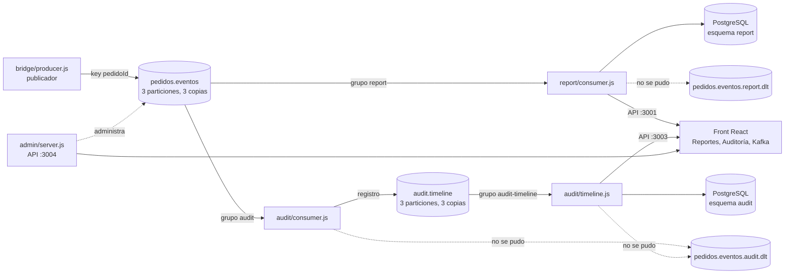

# Pedidos360 · Kafka

Streaming de eventos de pedidos de Pedidos360 (pizzería con 3 sucursales en
Santiago) sobre un clúster Kafka de 3 brokers. Cada cambio de estado de un
pedido es un evento en `pedidos.eventos`. Dos servicios lo consumen, cada uno
en su propio grupo:

- **report** calcula KPIs (ventas por hora, top de productos, pedidos activos,
  lead time por sucursal) y los guarda en PostgreSQL.
- **audit** arma el historial legible de cada pedido (quién, qué, cuándo y
  desde dónde), lo publica en `audit.timeline` y un lector lo guarda en
  PostgreSQL.

Un **microservicio administrador** gestiona tópicos, grupos de consumidores y
las DLT. Las tres APIs validan el JWT de Entra ID que ya usa el front de la
EP4, y el front tiene las pantallas Reportes, Auditoría y Kafka.

Todo es Node.js 24 con [KafkaJS](https://kafka.js.org/) y Express. El front es
React (repo `pedidos360-entra-id-starter-main`).

## Arquitectura



| Componente | Puerto | Grupo | Lee | Escribe |
|---|---|---|---|---|
| `bridge/producer.js` (publicador) | — | — | — | `pedidos.eventos` |
| `report/consumer.js` | API 3001 | `report` | `pedidos.eventos` | PostgreSQL `report`, DLT de report |
| `audit/consumer.js` | — | `audit` | `pedidos.eventos` | `audit.timeline`, DLT de audit |
| `audit/timeline.js` | API 3003 | `audit-timeline` | `audit.timeline` | PostgreSQL `audit`, DLT de audit |
| `admin/server.js` | API 3004 | — | (administra el clúster) | tópicos, offsets, reproceso de DLT |
| Kafka UI | 8080 | — | — | — |
| Brokers | 9092, 9093, 9094 | — | — | — |
| PostgreSQL | 5433 | — | — | — |

## Cómo levantarlo

Requisitos: Docker Desktop y Node.js 22 o superior.

```bash
cp .env.example .env    # completar PGPASSWORD, ENTRA_TENANT_ID y ENTRA_API_CLIENT_ID
npm install
npm run up              # ZooKeeper, 3 brokers, Kafka UI y PostgreSQL (espera a que estén sanos)
npm run topics          # crea los 4 tópicos con su configuración
npm run db              # crea los esquemas y tablas de report y audit
```

Después, cada servicio en su terminal:

```bash
npm run report      # KPIs, API en :3001
npm run audit       # historial -> audit.timeline
npm run timeline    # audit.timeline -> PostgreSQL, API en :3003
npm run admin       # administrador, API en :3004
npm run producer    # 5.000 eventos en unos 60 segundos
```

| Script | Qué hace |
|---|---|
| `npm test` | 81 pruebas, sin Kafka ni PostgreSQL |
| `npm run up` / `down` | Levanta o detiene el clúster (los datos quedan en volúmenes) |
| `npm run reset` | Detiene y **borra** los datos de Kafka y PostgreSQL |
| `npm run topics` | Deja los tópicos como dice `shared/topics.js` (se puede correr las veces que sea) |
| `npm run db` | Crea las tablas si faltan y muestra cuántas filas tiene cada una |
| `npm run producer -- 200` | 200 eventos (por defecto 5.000) |
| `npm run producer -- --segundos 0` | Sin pausas, lo más rápido posible |
| `npm run producer -- --salto` / `--duplicado` / `--total-malo` / `--malo` | Casos de error, uno a la vez |
| `npm run report -- --grupo report-v2 --memoria --puerto 3002` | Replay: un grupo nuevo reconstruye los KPIs desde el primer evento |
| `npm run report -- --lento 20` | 20 ms por evento: para ver el lag y escalar con más instancias |

## Dónde está cada cosa

| Lo que se evalúa | Dónde |
|---|---|
| Clúster con ZooKeeper, 3 brokers y Kafka UI | `docker-compose.yml` |
| Configuración del cliente Kafka (brokers, productor, consumidor) | `shared/kafka.js`, `.env` |
| Tópicos: particiones, réplicas, retención, cleanup policy | `shared/topics.js`, aplicados con `admin/setup.js` |
| DTO del evento y su validación | `shared/dto.js` |
| Serializer y deserializer | `shared/serializador.js` (evento), `audit/registro.js` (registro de auditoría) |
| Productores | `bridge/producer.js` (a `pedidos.eventos`), `audit/auditoria.js` (a `audit.timeline`) |
| Consumidores | `report/consumer.js`, `audit/consumer.js`, `audit/timeline.js` |
| Consumidor genérico: reintentos, DLT, logs, rebalanceo | `shared/consumidor.js` |
| Lógica de negocio, separada de Kafka | `report/kpis.js`, `audit/auditoria.js`, `shared/estados.js` |
| Consumer groups | `report`, `audit`, `audit-timeline` (y `report-v2` para replay) en cada `consumer.js` |
| Guardado en la base de datos | `report/repositorio.js`, `audit/repositorio.js`, `db/esquema.sql`, `shared/db.js` |
| Microservicio administrador | `admin/api.js` (rutas), `admin/servicio.js` (tópicos), `admin/grupos.js`, `admin/dlt.js` |
| Filtro JWT | `shared/auth.js`, conectado en `shared/http.js` |
| Pruebas | `pruebas/*.test.js` |

## El evento

Cada mensaje de `pedidos.eventos` lleva como **key** el `pedidoId` y como
**value** el DTO en JSON. En los headers van `correlationId` (el mismo para
toda una corrida del publicador) y `tipo`.

```json
{
  "eventId": "48ce464a-2108-436a-a1d6-64bfd99d221c",
  "tipo": "PEDIDO_CREADO",
  "version": 2,
  "fecha": "2026-11-14T07:24:49.895Z",
  "pedidoId": "PED-91BF-000001",
  "clienteId": "CLI-0462",
  "total": 41940,
  "actor": { "usuarioId": "OPE-03", "rol": "OPERADOR" },
  "estadoAnterior": null,
  "estadoNuevo": "CREADO",
  "items": [
    { "productoId": "PRD-004", "nombre": "Pizza Vegetariana", "categoria": "PIZZAS", "cantidad": 3, "precioUnitario": 10990 },
    { "productoId": "PRD-010", "nombre": "Bebida 1,5 L", "categoria": "BEBIDAS", "cantidad": 2, "precioUnitario": 2990 }
  ],
  "canal": "TELEFONO",
  "comuna": "Puente Alto",
  "sucursalId": "SUC-03"
}
```

- `tipo`: `PEDIDO_CREADO`, `PEDIDO_ACEPTADO`, `PEDIDO_EN_PREPARACION`,
  `PEDIDO_DESPACHADO`, `PEDIDO_ENTREGADO` o `PEDIDO_CANCELADO`. Cada tipo
  corresponde a un `estadoNuevo`.
- `items` solo viene en `PEDIDO_CREADO`; los demás eventos lo traen vacío.
- `total` es la suma de los items más el despacho ($2.990): en el ejemplo,
  32.970 + 5.980 + 2.990 = 41.940.
- `shared/dto.js` valida todo antes de publicar y al consumir: formatos
  (`PED-XXXX-NNNNNN`, `CLI-NNNN`, `PRD-NNN`, `SUC-NN`), tipos, que el estado
  calce con el tipo y que **el total no sea menor que la suma de los items**.
  Un evento inválido no se publica, y si llega igual, va a la DLT.

Los estados siguen la tabla del caso (`shared/estados.js`):

```
CREADO -> ACEPTADO -> EN_PREPARACION -> DESPACHADO -> ENTREGADO
   |          |              |
   +----------+--------------+--> CANCELADO
```

## Tópicos

| Tópico | Particiones | Copias | min ISR | Retención | Tope por partición | Limpieza |
|---|---|---|---|---|---|---|
| `pedidos.eventos` | 3 | 3 | 2 | 7 días | 256 MB | delete |
| `audit.timeline` | 3 | 3 | 2 | 30 días | 256 MB | delete |
| `pedidos.eventos.report.dlt` | 1 | 3 | 2 | 14 días | 64 MB | delete |
| `pedidos.eventos.audit.dlt` | 1 | 3 | 2 | 14 días | 64 MB | delete |

Los valores viven en `shared/topics.js`, con la razón de cada uno al lado.
`npm run topics` los aplica: crea lo que falta y corrige lo que alguien haya
cambiado a mano. La creación automática de tópicos está apagada en los brokers
(`KAFKA_AUTO_CREATE_TOPICS_ENABLE: false`): un nombre mal escrito falla en vez
de crear un tópico nuevo sin que nadie se dé cuenta.

## Productor, consumidores y grupos

**Productor** (`shared/kafka.js`, `CONFIG_PRODUCTOR` y `OPCIONES_ENVIO`):
idempotente, `acks=all`, un envío en vuelo por broker, compresión GZIP y el
mismo particionador que el cliente oficial de Java (murmur2 sobre la key). El
publicador manda los 5.000 eventos en lotes de 100, repartidos parejo en los
segundos que se le pidan.

**Consumidores** (`shared/consumidor.js`): todos usan el mismo consumidor
genérico. Cada servicio solo entrega su función `procesar`:

| Servicio | `procesar` | Qué hace con cada evento |
|---|---|---|
| report | `aplicarEvento` (`report/kpis.js`) | Revisa la transición y actualiza el pedido en una transacción |
| audit | `publicarRegistro` (`audit/auditoria.js`) | Arma el registro y lo publica en `audit.timeline` |
| timeline | `repo.guardar` (`audit/repositorio.js`) | Inserta el registro |

**Grupos:** `report` y `audit` leen el mismo tópico en grupos distintos, así
**cada uno recibe todos los eventos**. Dentro de un grupo, las 3 particiones
se reparten entre las instancias que haya: se puede levantar el mismo servicio
varias veces para dividir la carga, hasta 3 instancias por grupo. Cada
instancia avisa en su log qué particiones le tocaron después de cada
rebalanceo.

| Ajuste del consumidor | Valor | Por qué |
|---|---|---|
| `sessionTimeout` | 30 s | Sin latidos por 30 s, el grupo da por caída la instancia y reparte sus particiones |
| `heartbeatInterval` | 3 s | Perder uno o dos latidos no basta para sacarla |
| `fromBeginning` | `true` | Un grupo nuevo parte desde el primer evento (replay) |
| Apagado con Ctrl+C | `consumer.disconnect()` | Sale del grupo de inmediato: el rebalanceo no espera los 30 s |

## Errores, reintentos y DLT

Por cada mensaje, `shared/consumidor.js` hace esto:

1. Lo deserializa y lo valida con el DTO.
2. Se lo entrega a `procesar`.
3. Si falla por algo pasajero (por ejemplo, la base no responde), **reintenta
   a los 1, 2 y 4 segundos**, avisando al grupo que sigue vivo.
4. Si el error no tiene arreglo (JSON roto, DTO inválido, transición
   inválida) o se acabaron los reintentos, manda el mensaje a la **DLT del
   servicio** y sigue con el siguiente. Un mensaje malo nunca bloquea su
   partición.

El mensaje llega a la DLT con su key, su value original (aunque no sea JSON)
y sus headers, más estos:

| Header | Ejemplo |
|---|---|
| `dlt-motivo` | `transición inválida`, `JSON inválido`, `se agotaron los reintentos` |
| `dlt-error` | `connect ECONNREFUSED 127.0.0.1:5433` |
| `dlt-servicio`, `dlt-grupo` | `report`, `report` |
| `dlt-topico`, `dlt-particion`, `dlt-offset` | `pedidos.eventos`, `0`, `1746` |
| `dlt-intentos`, `dlt-fecha` | `4`, `2026-11-14T17:25:55.000Z` |

Cada envío a la DLT queda en el log con el grupo, la partición, el offset, la
key y el `correlationId`, y cada 5 segundos el consumidor resume lo procesado
(`5000 mensajes: 4997 aplicado, 3 dlt`).

**Reproceso:** el admin devuelve los mensajes pendientes de una DLT a su
tópico de origen, sin los headers `dlt-*`. Su avance queda marcado en los
offsets del grupo `<servicio>-dlt-reproceso`: el lag de ese grupo es lo que
falta reprocesar. Es seguro porque los consumidores son idempotentes (ver
ADR-006). Lo que no tiene arreglo vuelve a caer en la DLT.

## Microservicio administrador

API en `http://localhost:3004/api/admin` (`admin/api.js`). Solo un usuario con
el App Role **Admin** y el scope `messaging.manage`.

| Método y ruta | Qué hace |
|---|---|
| `GET /cluster` | Brokers y controlador |
| `GET /topicos` | Todos los tópicos (sin los internos) con su configuración y cantidad de mensajes |
| `POST /topicos` | Crea un tópico (por defecto, igual que `pedidos.eventos`) |
| `GET /topicos/:nombre` | Líder, copias e ISR de cada partición, configuración y grupos que lo leen |
| `PATCH /topicos/:nombre/configuracion` | Cambia retención, tope por partición, limpieza o min ISR |
| `POST /topicos/:nombre/particiones` | Agrega particiones (el total nuevo) |
| `DELETE /topicos/:nombre` | Lo borra |
| `GET /grupos` | Grupos con estado, instancias y lag |
| `GET /grupos/:grupo` | Qué particiones tiene cada instancia y el offset y lag de cada partición |
| `POST /grupos/:grupo/offsets` | Mueve el grupo al `inicio`, al `fin` o a una fecha |
| `DELETE /grupos/:grupo` | Lo borra |
| `GET /dlt/:servicio` | Los últimos mensajes de la DLT de `report` o `audit`, con su motivo |
| `POST /dlt/:servicio/reprocesar` | Devuelve los pendientes a su tópico de origen |

Respuestas de error: **400** si se pide mal (campo desconocido, valor fuera
de rango), **404** si no existe y **409** si chocaría con el estado del
clúster:

- Los tópicos de Pedidos360 no se borran ni cambian de particiones desde la
  API, porque eso no se puede deshacer: se cambia en `shared/topics.js` y se
  aplica con `npm run topics`. Su configuración sí se puede cambiar, y la
  respuesta avisa que `npm run topics` la devuelve al valor del código.
- No se borra un tópico que un grupo está leyendo.
- No se mueven los offsets ni se borra un grupo con instancias conectadas
  (Kafka no lo permite).
- Kafka no permite quitar particiones, solo agregar.

## Seguridad

Las tres APIs (report, audit y admin) aceptan el mismo access token de Entra
ID que el front pide para **Pedidos360-API** en la EP4. El filtro
(`shared/auth.js`) revisa la firma con las llaves públicas del tenant
(solo RS256), el emisor, la audiencia, la vigencia, el scope y el App Role.

| API | Scope | App Role |
|---|---|---|
| Reportes (3001) | `orders.read` | Operador o Admin |
| Auditoría (3003) | `orders.read` | Admin |
| Admin de Kafka (3004) | `messaging.manage` | Admin |

Sin token o con uno inválido responde **401** (con el motivo: vencido, firma
que no es de Entra, otra audiencia...). Con un token válido pero sin el scope
o el rol, **403**. Si Entra ID no responde al bajar las llaves, **503**: no se
culpa al usuario de algo que no es su culpa. `crearApp` exige el filtro: una
API sin él no arranca.

Los secretos van en `.env`, que no se sube al repositorio (`.gitignore`). La
contraseña de PostgreSQL no tiene valor por defecto: sin `.env`,
`docker compose` no levanta la base.

## Pruebas

```bash
npm test
```

81 pruebas con `node:test`, sin Kafka ni PostgreSQL: el DTO, el simulador,
las transiciones, el consumidor genérico (reintentos y DLT con dobles de
prueba), los KPIs con el repositorio en memoria, audit, el admin con un Kafka
falso en memoria y el filtro JWT con tokens firmados por llaves propias.

### Prueba completa (14-11-2026)

Desde cero (`npm run reset`), con el front abierto:

| Fase | Qué se hizo | Resultado |
|---|---|---|
| 1. 5.000 eventos | `npm run producer` con report, audit y timeline corriendo | `report.eventos_aplicados` 5000 = `audit.registros` 5000; 1072 pedidos en la base y en la pantalla Reportes; lag 0 |
| 2a. Replay | `npm run report -- --grupo report-v2 --memoria --puerto 3002` | `/api/report/resumen` idéntico en 3001 (PostgreSQL) y 3002 (memoria) |
| 2b. Escalado | El admin devolvió `report-escala` al inicio y se levantaron 4 instancias con `--lento 20` | Una partición por instancia y la cuarta "ninguna (hay más instancias que particiones)"; lag de 5.000 a 0 en unos 40 s (una sola instancia tarda unos 100 s) |
| 3. PostgreSQL caído | `docker compose stop postgres` y 10 eventos | Reintentos a los 1, 2 y 4 s, y a la DLT cada 7 s: 10 en la de report y 10 en la de audit. Con la base de vuelta, reproceso desde la pantalla Kafka: 5010 = 5010 |
| 4a. Mensajes malos | `--salto`, `--duplicado`, `--total-malo`, `--malo` | A la DLT al instante, sin reintentos (3 en report y 2 en audit); el duplicado se cuenta una vez; auditoría registra el salto |
| 4b. Broker caído | 3.000 eventos en 40 s y `docker compose stop kafka-2` en medio | 2 brokers y 8 particiones con copias atrasadas; el publicador siguió enviando. Al volver el broker, 0 atrasadas y 8012 / 8013 en la base: nada perdido ni duplicado |

## Decisiones de diseño

Cada decisión dice qué se eligió, qué otras opciones había y qué costo tiene.

| ADR | Decisión | Dónde está |
|---|---|---|
| 001 | Kafka en Docker Compose, no Amazon MSK | `docker-compose.yml` |
| 002 | 3 copias, `min.insync.replicas` 2, `acks=all` y productor idempotente | `docker-compose.yml`, `shared/kafka.js`, `shared/topics.js` |
| 003 | 3 particiones y key `pedidoId` | `shared/topics.js`, `bridge/producer.js` |
| 004 | Retención y limpieza por tópico, aplicadas desde el código | `shared/topics.js`, `admin/setup.js` |
| 005 | Una DLT por servicio | `shared/topics.js`, `shared/consumidor.js` |
| 006 | Entrega "al menos una vez" con consumidores idempotentes | `report/kpis.js`, `audit/repositorio.js` |
| 007 | PostgreSQL con un esquema por servicio | `db/esquema.sql`, `shared/db.js` |
| 008 | Report aplica las reglas; auditoría registra todo | `report/kpis.js`, `audit/auditoria.js` |
| 009 | El admin no deshace lo que no se puede deshacer | `admin/servicio.js`, `admin/grupos.js` |
| 010 | El mismo token de Entra ID, y sin filtro no hay API | `shared/auth.js`, `shared/http.js` |

### ADR-001: Kafka en Docker Compose, no Amazon MSK

**Contexto.** Pedidos360 ya corre serverless en AWS (API Gateway, Lambda,
SNS/SQS, DynamoDB, Amplify). La EP5 pide un clúster con ZooKeeper, brokers y
Kafka UI levantado con Docker Compose.

| | A. Docker Compose local | B. Amazon MSK | C. Kafka en una EC2 |
|---|---|---|---|
| Lo que pide la pauta (compose, ZooKeeper, UI) | Sí | No: AWS administra los brokers | Sí, con más trabajo |
| Costo | Cero | Por hora, aunque no se use | Por hora |
| Complejidad | Baja | Alta: VPC, subredes, IAM | Media |
| Se puede botar un broker en la demo | Sí (`docker compose stop kafka-2`) | No | Sí |

**Decisión.** A.

**Consecuencias.** Se puede mostrar todo en vivo: brokers, líderes, réplicas y
una caída. Las Lambdas de AWS no llegan a un Kafka local, así que los eventos
de la demo los genera el publicador. Conectar la EP4 con Kafka sería un puente
SNS → una cola SQS nueva → un bridge → Kafka; queda documentado, no
implementado. En producción se usaría MSK con el mismo código: solo cambia
`KAFKA_BROKERS`.

### ADR-002: 3 copias, `min.insync.replicas` 2, `acks=all` y productor idempotente

**Contexto.** Un pedido confirmado no se puede perder aunque se caiga un
broker.

| | Copias | min ISR | Si se cae 1 broker | Si se caen 2 |
|---|---|---|---|---|
| A | 1 | 1 | Esas particiones quedan sin líder | Igual |
| B | 3 | 1 | Sigue funcionando | Acepta escrituras en una sola copia: si ese broker muere, se pierden |
| **C** | **3** | **2** | **Sigue funcionando** | **No acepta escrituras nuevas, pero no pierde nada** |

**Decisión.** C, con `acks=all` en cada envío, productor idempotente (un
reintento no duplica) y reintentos sin límite (con 2 brokers caídos, el
publicador espera y sigue solo cuando vuelve uno).

**Comprobado.** Con `kafka-2` detenido en medio de 3.000 eventos, los líderes
pasaron a los otros brokers, el ISR quedó en 2 copias y no se perdió ni
duplicó nada (prueba completa, fase 4b). Con `kafka-2` y `kafka-3` detenidos,
el broker rechazó los envíos (*fewer in-sync replicas than required*) y el
publicador esperó; al volver `kafka-3` terminó solo.

**Consecuencias.** Aguanta un broker caído sin dejar de recibir. Con dos
caídos prefiere no perder datos antes que seguir recibiendo. Cada mensaje
ocupa el triple de disco.

### ADR-003: 3 particiones y key `pedidoId`

**Contexto.** Los eventos de un pedido deben procesarse en orden (no se
despacha lo que no se aceptó), pero se quiere repartir la carga.

| | Orden | Instancias en paralelo por grupo |
|---|---|---|
| A. 1 partición | Total | 1 |
| **B. 3 particiones, key `pedidoId`** | **Por pedido** | **Hasta 3** |
| C. 12 particiones | Por pedido | Hasta 12, con más archivos, más líderes y rebalanceos más lentos |

**Decisión.** B: una partición líder en cada broker. Todos los eventos de un
pedido caen en la misma partición y se leen en el orden en que pasaron.

**Consecuencias.** Un grupo usa como máximo 3 instancias; la cuarta queda
esperando (se vio en la fase 2b). Para 5.000 eventos por minuto, unos 83 por
segundo, sobran. Se pueden agregar particiones pero no quitar, y agregar
cambia la partición de algunas keys: por eso en los tópicos de Pedidos360 solo
se hace desde el código.

### ADR-004: retención y limpieza por tópico, aplicadas desde el código

**Decisión.** La tabla de [Tópicos](#tópicos): 7 días para los eventos
(alcanza para reprocesar una semana o ponerse al día tras un fin de semana
caído), 14 para las DLT (más tiempo para investigar) y 30 para la auditoría.
La retención se cumple por tiempo o por tamaño, lo que pase primero.

**Opción descartada: `compact` en `audit.timeline`.** `compact` guarda solo el
último mensaje de cada key. Con key `pedidoId`, quedaría solo el último paso
de cada pedido y el historial perdería sus pasos. Por eso todos usan
`delete`.

**Consecuencias.** La configuración queda versionada en Git y se repite igual
en otro clúster. `npm run topics` corrige lo que se cambie a mano en Kafka UI.
`alterConfigs` reemplaza toda la configuración propia del tópico, así que el
admin manda la que ya tenía con los cambios encima.

### ADR-005: una DLT por servicio

**Contexto.** Un mensaje que no se puede procesar no debe bloquear su
partición, y hay que saber qué falló.

| | Se sabe quién falló | Funciona con grupos nuevos (replay) |
|---|---|---|
| A. Una DLT para todos | Solo leyendo los headers | Sí |
| B. Una DLT por grupo | Sí | No: la creación automática está apagada y un grupo nuevo no tendría DLT |
| **C. Una DLT por servicio** | **Sí** | **Sí** |

**Decisión.** C, con 1 partición cada una: llegan pocos mensajes y así quedan
en una sola fila, en orden, para revisarlos y reprocesarlos.

**Consecuencias.** Un error de report no se mezcla con uno de audit. Un
servicio nuevo necesita su DLT en `shared/topics.js`. Como cada grupo lee el
tópico completo, un mensaje malo aparece una vez por cada grupo del servicio
(`report` y `report-v2`, por ejemplo), y el header `dlt-grupo` dice cuál.

### ADR-006: "al menos una vez" con consumidores idempotentes

**Contexto.** KafkaJS confirma el offset después de procesar. Si una
instancia se cae entre procesar y confirmar, el mensaje se vuelve a leer.
Además, el reproceso de una DLT devuelve mensajes a un tópico que lee más de
un grupo.

| | Riesgo |
|---|---|
| A. Confirmar antes de procesar ("como máximo una vez") | Una caída pierde el evento |
| **B. Confirmar después y descartar repetidos por `eventId`** | **Ninguno: un repetido no cambia nada** |
| C. Transacciones de Kafka ("exactamente una vez") | Solo cubre Kafka → Kafka; la escritura en PostgreSQL queda fuera |

**Decisión.** B. Report guarda cada `eventId` aplicado en
`report.eventos_aplicados`, en la misma transacción que el cambio del pedido.
Si ya estaba, responde `duplicado` y no toca nada. Timeline inserta con
`ON CONFLICT (event_id) DO NOTHING`.

**Consecuencias.** Se puede reprocesar una DLT, mover un grupo al inicio o
repetir un evento sin riesgo (fases 2b, 3 y 4a: los conteos no cambiaron). La
tabla `eventos_aplicados` crece con cada evento.

### ADR-007: PostgreSQL con un esquema por servicio

**Contexto.** Report y audit necesitan guardar su estado, y la regla de
microservicios es que cada uno es dueño de sus datos.

**Decisión.** Un solo PostgreSQL 16 en Docker (puerto 5433, porque el 5432 lo
usa una instalación local), con un esquema por servicio: `report` y `audit`.
Cada servicio solo toca el suyo. Las consultas son parametrizadas, y los
cambios de un evento van en una transacción con `FOR UPDATE` sobre el pedido.

**Consecuencias.** Es más simple que dos bases y respeta la separación. Cada
servicio tiene además un repositorio en memoria con los mismos métodos: las
pruebas corren sin base, y el replay (`--memoria`) reconstruye los KPIs sin
tocarla.

### ADR-008: report aplica las reglas; auditoría registra todo

**Contexto.** Un evento puede llegar con una transición que no corresponde
(por ejemplo, de CREADO a DESPACHADO).

**Decisión.** Report revisa la tabla de transiciones antes de actualizar un
pedido: si no corresponde, el evento va a su DLT y los KPIs no cambian.
Auditoría registra cualquier evento con un DTO válido, aunque la transición
sea inválida, porque su trabajo es dejar constancia de lo que pasó.

**Consecuencias.** En la fase 4a, el pedido `PED-SALTO-44E8` quedó en la DLT de
report y, a la vez, con sus dos pasos en el historial de Auditoría. Por eso
`audit.registros` puede tener uno más que `report.eventos_aplicados`.

### ADR-009: el admin no deshace lo que no se puede deshacer

**Contexto.** Desde la API se puede borrar tópicos, agregar particiones y
mover offsets.

**Decisión.** En los tópicos de Pedidos360 (los de `shared/topics.js`) la API
responde **409** a borrar y a agregar particiones: esas operaciones no se
pueden deshacer y se deciden en el código. La configuración sí se puede
cambiar, con un aviso. Los offsets se guardan como números reales (el
`resetOffsets` de KafkaJS guarda -1 y -2, y con -1 los consumidores volverían
a leer todo). Leer una DLT usa un consumidor de un solo uso que no confirma
offsets y cuyo grupo se borra al terminar.

**Consecuencias.** La API sirve para operar y experimentar (crear un tópico
de prueba, mover un grupo para un replay, reprocesar una DLT) sin poder
romper lo que usan los servicios.

### ADR-010: el mismo token de Entra ID, y sin filtro no hay API

**Contexto.** El enunciado pide que el backend valide el JWT del IDaaS y que
el front lo use.

**Decisión.** Las APIs de Kafka aceptan el token que el front ya pide para
Pedidos360-API, con los scopes y App Roles de la EP4 (tabla en
[Seguridad](#seguridad)). Se aceptan los dos formatos de token de Entra (v1 y
v2), igual que el authorizer del API Gateway de la EP4. `crearApp` no crea una
API sin filtro.

**Consecuencias.** No hay que registrar nada nuevo en Entra ID y el front
usa el login de siempre. En el front publicado en Amplify no aparecen las
pantallas de Kafka, porque estas APIs corren en el equipo local.
